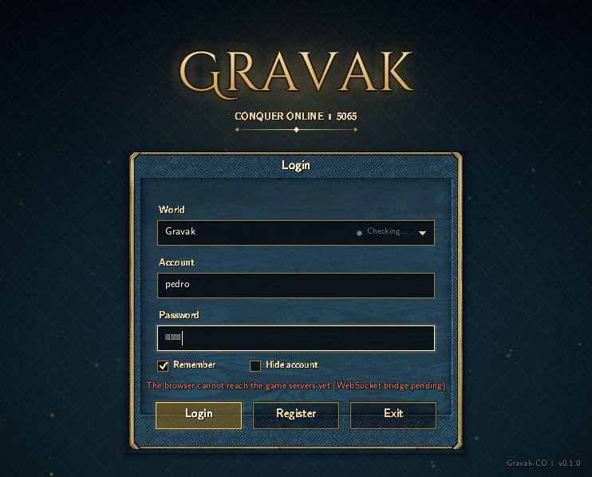

# Gravak no navegador — fase 1 (spike de viabilidade)

**Resultado:** o cliente Rust (`client/crates/sandbox`) compila para
`wasm32-unknown-unknown` e a tela de login roda no navegador: arte do jogo,
fontes, digitação, foco, cliques, senha mascarada e o botão Login (que responde
"The browser cannot reach the game servers yet (WebSocket bridge pending)").
O build nativo continua igual (`cargo build -p conquer-sandbox`, 212 + 23 testes
passando).



Branch do spike: `claude/modest-payne-64597b` — **não** foi mesclada na `main`.

## Como rodar

```bash
rustup target add wasm32-unknown-unknown
cargo install wasm-bindgen-cli --version 0.2.128 --locked
```

```powershell
client\tools\build-web.ps1                          # dados de client\dist\Gravak\game
client\tools\build-web.ps1 -Game R:\5065            # ou de uma instalação
```

A saída vai para `client\dist\web` (página, `gravak.js`, `gravak_bg.wasm` e
`assets\`). Para servir: entrada `web-spike` do `.claude\launch.json`
(`python -m http.server 8099 --directory client/dist/web`) e abrir
`http://localhost:8099`.

O script compila o cliente nativo uma vez para copiar os arquivos do pack
(`conquer-sandbox --export-assets <game> <saída> <arquivo>...`). O pack de
distribuição usa a chave de release, então o exportador é compilado com
`installer\pack.key` (ou `-KeyFile`). A chave nunca vai para o wasm nem para o
repositório.

## O que foi feito

Tudo atrás de `cfg(target_arch = "wasm32")`; no nativo o código é o mesmo de antes.

| Área | Nativo | Navegador (spike) |
|---|---|---|
| Entrada | `main()` → `run()` (args, `gravak.ini`, event loop bloqueante) | `main()` → `web::start()`: busca `assets/manifest.txt` e os arquivos por `fetch`, monta `Assets::from_memory`, abre as telas com `EventLoop::spawn_app` (não bloqueia) |
| Janela | janela do winit, 1024×768 | `<canvas>` anexado ao `<body>` (`with_append`), do tamanho da página; o winit segue o tamanho CSS |
| Telas de login | `softbuffer` | o mesmo `softbuffer` (backend canvas 2D), sem mudança no desenho |
| Renderer wgpu | `pollster::block_on(Renderer::new)` | `wasm_bindgen_futures::spawn_local`; o renderer chega em `about_to_wait` (`App::renderer_ready`). wgpu com `webgpu` + `webgl` só no alvo wasm. Compila, mas o mundo ainda não é alcançado no navegador |
| Tempo | `std::time::Instant` | `web_time::Instant`/`SystemTime` (o do std entra em pânico no wasm). No nativo `web_time` reexporta o std |
| Rede (`login.rs`, `network.rs`, `gravak-protocol`) | tokio + TCP | sem TCP: `GameSession`, `authenticate`, `register_account` e `connect_game` só no nativo; `LoginClient`/`NetworkHandle` respondem na hora com erro |
| Status dos mundos (`worlds::watch`) | thread + TCP | a thread não sobe; fica "Checking…" |
| Threads (15 lugares) | `std::thread` | `std::thread::spawn` entra em pânico no wasm. As do caminho do login (`showcase`, `login_scenes`) passaram a usar `Builder::spawn` e simplesmente não rodam: sem os heróis da criação de personagem e sem as vistas do mundo ao fundo |
| Arquivos de config (`settings.rs`, `keybinds.rs`, `helper.rs`, `sell_all.rs`) | `std::fs` | no-op: o `std::fs` do wasm compila e devolve erro, e esses módulos já caem nos padrões |
| Atualizador (`updater.rs`) | ureq + troca de arquivos | `start` responde `UpToDate` (o site sempre serve a última versão) |
| Loja de CPs (`cp_shop.rs`) | ureq | responde "Buy CPs on the website for now." |
| Discord (`discord.rs`) | named pipe / socket | sem pipe (`open` → `None`) |
| Clipboard | arboard | `clipboard_text()` → `None` e copiar não faz nada (a API do navegador é assíncrona e pede permissão) |
| Fontes do sistema (`fontdb`) | `load_system_fonts` | `fonts::load_system_fonts` embute a KaTeX SansSerif (SIL OFL, 19 KB) e responde por toda família |
| Áudio | rodio | `audio_web.rs`: mesma API, em silêncio |

Também foi incluído o `GRAVAK_TRACE_ASSETS=1` (nativo e web): lista cada arquivo
lido por `Assets::read`. No navegador, todo arquivo que falta aparece no console
como `ASSET missing <caminho>`. É assim que se monta o `client/web/assets.txt`
de cada tela.

Arquivos de jogo que a tela de login precisa: **1**, `data/main/GeneralBG.dds`
(128 KiB). O resto (logo, painéis, botões, brasas) é desenhado pelo cliente.

## Medidas

**Tamanho do wasm** (release, depois do `wasm-bindgen`, **sem** `wasm-opt`):

| Build | Cru | gzip -9 |
|---|---|---|
| Só login (o que o spike entrega) | 2,07 MB | 0,66 MB |
| Cliente inteiro alcançável (medição à parte, forçando o caminho do jogo com `black_box`) | 8,88 MB | 2,75 MB |

O build do spike é pequeno porque o compilador corta o mundo como código morto.
O número que importa para as próximas fases é o de ~9 MB (≈2,8 MB pela rede).
`wasm-opt -Oz` e `opt-level = "z"` devem tirar mais uns 10–20%. Para
comparação, o `.exe` nativo release tem 16,4 MB.

**Frame rate** (Chromium do painel do app, tela de login em 742×598 e 1024×768):
**~55–60 fps** estáveis, com **7–9 ms** de CPU para pintar cada frame da tela
inteira em `RgbaImage` (`LoginUi::image`). Isso já deixa pouca folga: a tela
pinta tudo na CPU todo frame, e em 1920×1080 seriam ~2,6× os pixels (≈20 ms,
abaixo de 60 fps). Os primeiros segundos podem ficar em 1–2 fps enquanto a aba
não está visível (o navegador estrangula o `requestAnimationFrame`), o que é
normal. A carga inicial (manifest + 1 arquivo) leva 10–20 ms em localhost. O
console mostra `Gravak login: N fps, M ms to paint a frame` a cada 2 s.

O wgpu (WebGPU/WebGL2) **não foi medido**: o mundo ainda não abre no navegador.

## Bloqueios restantes e custo estimado

Estimativas em dias de trabalho focado de uma pessoa que conhece o código.

1. **Ponte WebSocket → TCP (auth 9958, jogo 5816)** — *2–4 dias.* Um proxy
   pequeno (Rust com tokio-tungstenite, ou `websockify`) na VPS, atrás do
   nginx com TLS (`wss://gravak.fun/ws/auth`, `/ws/game`). Ele só repassa
   bytes. A cifra TQ continua no cliente, que já usa os codecs
   `TQEncoder/TQDecoder` sobre um stream genérico. No cliente: um tipo de
   stream `AsyncRead + AsyncWrite` sobre `web_sys::WebSocket` (ou `ws_stream_wasm`)
   no lugar de `TcpStream` em `gravak-protocol`, e `login.rs`/`network.rs`
   rodando no `spawn_local` em vez de thread + runtime tokio (o desenho de
   canais command/event já serve). O servidor de jogo devolve IP:porta no
   `MsgConnectEx`; a ponte precisa mapear isso para a rota `wss` (e limitar a
   quais destinos aceita conectar). O status dos mundos (`worlds::watch`) vira
   uma tentativa de WebSocket ou um endpoint HTTP do site.
2. **Dados do jogo sob demanda (~447 MB do `gravak.gpk`)** — *1–2 semanas.*
   É o maior item. Hoje `Assets::read` é síncrono e tem ~100 chamadas. Proposta:
   servir o pack (ou entradas soltas) por HTTP com `Range`, a partir do índice
   do pack; um cache em IndexedDB (ou OPFS) por entrada; e
   pré-carregar por tela/mapa (como o `assets.txt` deste spike, mas gerado por
   `GRAVAK_TRACE_ASSETS`). Dá para manter `read` síncrono se cada cena só
   começa depois do seu "pacote" estar na memória, e assim evitar tornar
   assíncronas as ~100 chamadas. Os três loaders do renderer
   (`gravak-asset-loader`, `ui-texture-loader`, `geometry-loader`) e o
   `RemoteModelLoader` abrem um `Assets` próprio a partir de um caminho e
   precisam passar a receber uma fonte compartilhada. Ponto de decisão: a chave
   do pack teria de ir no wasm, onde é extraível (no `.exe` também, só que com
   mais esforço). A alternativa é servir as entradas já decifradas atrás de
   login.
3. **Threads** — *3–5 dias.* Os loaders de textura/geometria/modelos e a
   composição de cenas usam `std::thread`. Caminho simples: rodá-los em fatias
   no próprio loop (`spawn_local` + orçamento por frame). Caminho rápido de
   verdade: Web Workers com `wasm-bindgen-rayon`/atomics, que exigem
   `-C target-feature=+atomics`, nightly (`build-std`) e os cabeçalhos COOP/COEP
   no site. Sem isso, a decodificação de DDS/C3 trava o frame.
4. **Persistência** — *0,5–1 dia.* `settings.rs`, `keybinds.rs`, `helper.rs` e
   `sell_all.rs` gravam texto em arquivos: basta trocar a leitura/escrita por
   `localStorage` (chave = nome do arquivo). Contas salvas: o `vault` usa DPAPI
   no Windows, e no navegador não deve guardar senha (só a conta).
5. **Áudio** — *1–2 dias.* O rodio/cpal tem backend Web Audio (feature
   `wasm-bindgen` do cpal). A música MP3 pode ir direto para um elemento
   `<audio>`. O navegador só libera som depois do primeiro clique.
6. **Mundo com wgpu no navegador** — *2–4 dias depois de 1–3.* O caminho
   assíncrono já está escrito (`App::renderer_ready`). Falta: usar
   `wgpu::util::new_instance_with_webgpu_detection` para cair no WebGL2 quando não
   há WebGPU; checar limites de textura e formatos (sem BC/DXT em boa parte do
   WebGL, então os DDS têm de ser descomprimidos na CPU, como já são hoje
   para `RgbaImage`); e medir fps de verdade no mapa 1002.
7. **Detalhes de plataforma** — *1–2 dias.* Clipboard (evento `paste`), cursores
   próprios (`CustomCursor` funciona no web, mas não foi testado), tela cheia,
   fonte com mais glyphs (a KaTeX SansSerif não tem o caractere de máscara da
   senha, que aparece como caixinhas, nem acentos estendidos; trocar por uma Noto
   Sans/Liberation Sans OFL, ~300 KB), heróis e vistas do mundo na tela de login
   (dependem de 2 e 3), botão "Exit" (no navegador não fecha nada).
8. **Página `/play` no site Next.js (`web/`)** — *1–2 dias.* Servir
   `gravak.js`/`gravak_bg.wasm` com `Content-Type: application/wasm` e
   compressão, `index.html` vira um componente cliente que chama `init()`, e
   o nginx faz o proxy `wss`.

**Total grosso até jogar no navegador:** ~4–6 semanas, quase tudo nos itens
2 e 3. Nada encontrado no spike invalida o caminho de compilar o cliente
existente para wasm.

## Notas do ambiente

- No worktree (`.claude\worktrees\…`) o `cl.exe` do MSVC falha com D8050 ao
  compilar o C do `ring` quando o `target` fica dentro do worktree. Com
  `CARGO_TARGET_DIR` fora dele compila normalmente. O `build-web.ps1` aceita
  `GRAVAK_WEB_TARGET` para isso. No checkout normal não acontece.
- Para testar digitação por automação, mande teclas (`keydown`) e não
  `insertText`: o canvas do winit só escuta eventos de tecla.
